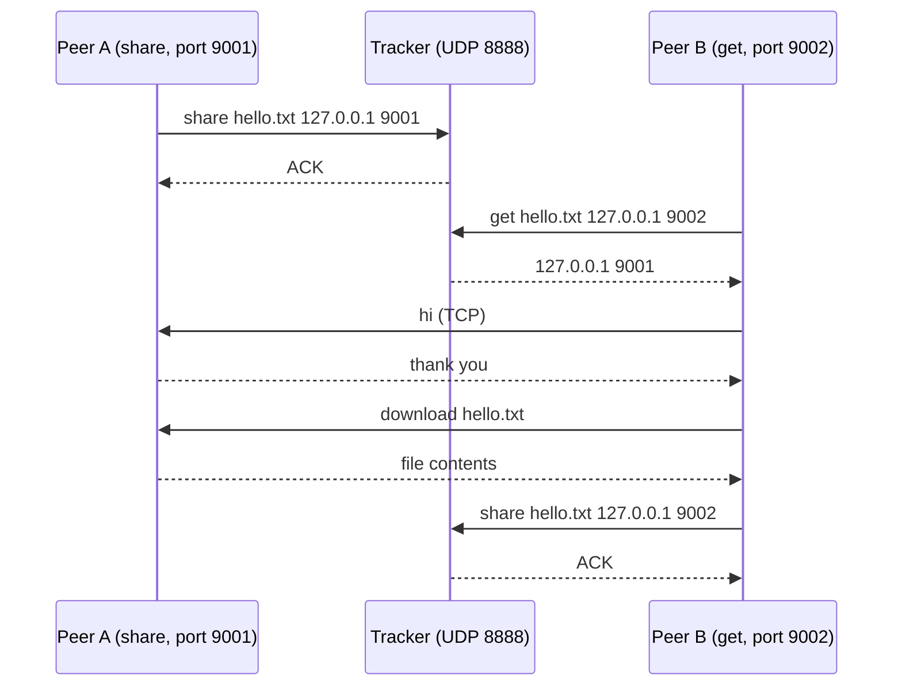

# BitTorrent-style peer-to-peer file sharing

A small file-sharing network in Python, modeled on how BitTorrent finds peers. A central tracker keeps track of which peer has which file, and the files themselves move directly between peers. A peer that downloads a file starts sharing it right away, so every download adds one more source for the next person.

I built this for the Computer Networks course at Sharif University of Technology (Spring 2023). It uses only the Python standard library: `socket` and `asyncio`.

## How it works

There are two programs.

`Tracker.py` is the tracker. It listens for UDP messages on `127.0.0.1:8888` and keeps a table from each file name to the peers that have it. It never sees the contents of a file.

`Peer.py` is a peer, started in one of two modes:

- In `share` mode it tells the tracker it has a file, then opens a TCP server on its own port and sends the file to anyone who asks.
- In `get` mode it asks the tracker who has a file, connects to that peer over TCP, downloads the file, and then switches to `share` mode for the same file.



The tracker uses UDP because its messages are short and each fits in one datagram. File transfers use TCP because the bytes have to arrive complete and in order.

### Messages

Peer to tracker, over UDP:

| Message | Reply |
|---|---|
| `share <file> <ip> <port>` | `ACK`, after the tracker records that the peer at `<ip> <port>` has `<file>` |
| `get <file> <ip> <port>` | `<ip> <port>` of a peer that has the file, chosen at random, or `NOT_FOUND` |

Between peers, over TCP:

| Message | Reply |
|---|---|
| `hi` | `thank you` |
| `download <file>` | the contents of the file |
| `ping` | `pong` |
| `quit` | closes the connection |

### Keeping the peer list fresh

Every 2 seconds the tracker opens a TCP connection to every peer it knows, sends `ping` and expects `pong`. A peer that doesn't answer is removed from the table, so the tracker stops handing out peers that have gone away. These checks are the repeated `connected to client` lines in a sharing peer's output.

### Where files live

Each peer keeps its files in a folder named after its own port. A peer sharing on port 9001 serves files from `./9001/`, and a peer downloading on port 9002 saves into `./9002/`, creating the folder if needed.

## Running it

You need Python 3.9 or newer. Open three terminals in the project folder.

1. Start the tracker:

   ```bash
   python Tracker.py
   ```

2. Put a file in a folder named after the first peer's port, and share it:

   ```bash
   mkdir 9001
   echo "hello from peer 9001" > 9001/hello.txt
   python Peer.py share hello.txt 127.0.0.1:8888 127.0.0.1:9001
   ```

3. Start a second peer that wants the file:

   ```bash
   python Peer.py get hello.txt 127.0.0.1:8888 127.0.0.1:9002
   ```

   Once it is connected and prints `thank you`, type `download` and press Enter.

The arguments are `<share|get> <file> <tracker ip:port> <this peer's ip:port>`.

Here is the second peer's output from a real run:

```
('127.0.0.1', 9002)
Peer found at 127.0.0.1 9001 sharing 'hello.txt'.
x=  127.0.0.1 9001
thank you
x = hello.txt
file received successfuly
got message from server : hello from peer 9001
```

After that, `./9002/hello.txt` holds the same text as `./9001/hello.txt`, and the second peer is sharing it on port 9002.

### Tracker commands

While the tracker runs, you can type these commands into its terminal:

| Command | What it prints |
|---|---|
| `file_logs -all` | every file and the peers that have it |
| `file_logs>hello.txt` | the peers that have one file |
| `request logs` | the last request from each peer address |

After the run above, `file_logs -all` shows that both peers now have the file:

```
hello.txt : {'127.0.0.1 9001', '127.0.0.1 9002'}
```

## Limitations

Next to real BitTorrent this is very much a teaching version, and it has some rough edges I know about:

- A file is sent in a single `recv` of at most 2048 bytes and handled as text, so it only works for small text files. Real BitTorrent splits files into pieces and can download different pieces from different peers at the same time. Here one peer sends the whole file.
- The tracker always listens on `127.0.0.1`, so everything has to run on one machine.
- After connecting, the downloading peer waits for you to type `download` instead of starting on its own.
- A sharing peer prints a `RuntimeWarning` when someone connects, because the greeting `connected to server` is never awaited and so never sent. It doesn't affect the transfer.
- When the tracker drops a peer, its message prints a literal `{p}` instead of the peer's address, because the f-string prefix is missing.

## Ideas for improving it

- Split files into fixed-size pieces with a hash for each, and let a peer fetch pieces from several peers at once.
- Read the transfer in a loop until the whole file has arrived, and keep it as bytes so binary files work.
- Let the tracker listen on any address so peers can run on different machines.
- Start the download automatically once a peer is found.

## Project layout

```
Tracker.py   the tracker: UDP server, peer table, keep-alive checks, console commands
Peer.py      a peer: share mode (TCP file server) and get mode (TCP client)
```
